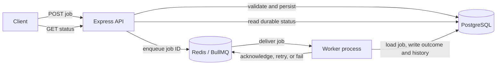

# Architecture (Milestone 1 proposal)

## Goal and boundaries

Build a small asynchronous job system that can be run and understood locally. The first version is a modular monolith with two process entry points: an HTTP API and one or more worker processes. They share code and infrastructure; they are not independently deployed microservices.

Supported job types should be deliberately small, such as simulated report generation and bounded data processing. Jobs should carry validated input and an explicit type; arbitrary code execution is out of scope.

## Implementation status

The current code implements the Express API, Zod request validation, a `JobService`, and a Prisma repository backed by PostgreSQL. A successful submission is durably stored with `PENDING` status and survives API restarts. There is no Redis queue or worker yet, so `PENDING` means only that the database has the record; it does not mean queue delivery or execution has happened.

## Components

- **Express API** accepts and validates requests, invokes application services, and returns HTTP responses.
- **Job service and repository** keep route handlers thin and isolate job lifecycle rules from storage.
- **PostgreSQL via Prisma** is the durable source for job metadata, results, errors, timestamps, and execution history.
- **Redis via BullMQ** provides asynchronous delivery, delayed availability, retry scheduling, and queue-level state.
- **Worker process** consumes queue messages, runs the handler for a known job type, and records lifecycle updates.

The queue and database have different responsibilities. BullMQ state describes delivery and processing; PostgreSQL describes the application's durable job record. They can temporarily disagree, and the implementation must expose and document this rather than treating either as a magical shared transaction.

## Submission and execution flow

The implemented database-only sequence is:

1. Client submits a job to `POST /api/jobs`.
2. API validates the type and payload, then persists a job record in PostgreSQL.
3. API returns the durable record with `PENDING` status.
4. Clients read durable job status through the API.

The later queue and worker milestones will add enqueue, execution, and completion updates around this foundation.

The Prisma model stores job payload and result as PostgreSQL `JSONB`. Job lifecycle and job type are enums, which constrain stored values. A separate `JobExecution` row is designed for each attempt; the worker will write these in a later milestone. The paginated list reads its rows and total count in a PostgreSQL `RepeatableRead` transaction so both are based on the same snapshot.

## Consistency and failure boundary

The initial design writes the PostgreSQL record before enqueueing. If enqueue fails, an accepted database row may remain without a queue item. The API must not silently report success in that case; the implementation milestone will choose an explicit response/state and recovery behavior. A transactional outbox can close this gap more robustly, but it adds machinery and is deferred until the simpler path is implemented and understood.

A worker may perform a side effect and crash before the queue acknowledgement or database completion update. The job may run again. The system must therefore avoid claiming exactly-once execution. Handlers should be idempotent where practical, and status transitions and duplicate-delivery behavior must be made explicit.

## Planned API surface

- `POST /api/jobs` submit a validated job, with optional priority, delay, and idempotency key as later milestones allow.
- `GET /api/jobs/:id` retrieve the durable status and available outcome.
- `GET /api/jobs` list jobs with bounded pagination and filters.
- `POST /api/jobs/:id/cancel` request cancellation where the job has not started or the handler supports cooperative cancellation.
- `GET /api/queues/:name/stats` expose useful queue counts.
- `GET /health` report API and dependency health.

Exact status codes, schemas, and implemented capabilities belong in API documentation once the endpoints exist.

## Growth path

Start with one queue and configurable worker concurrency. At higher load, measure enqueue-to-start latency, processing duration, throughput, failure rate, and database/Redis pressure before adding queue partitioning, an outbox, or more advanced observability. No performance claim should be made without reproducible measurements.
