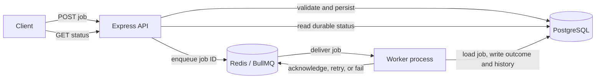

# Architecture (Milestone 4 implementation)

## Goal and boundaries

Build a small asynchronous job system that can be run and understood locally. The first version is a modular monolith with two process entry points: an HTTP API and one or more worker processes. They share code and infrastructure; they are not independently deployed microservices.

Supported job types should be deliberately small, such as simulated report generation and bounded data processing. Jobs should carry validated input and an explicit type; arbitrary code execution is out of scope.

## Implementation status

The current code implements the Express API, Zod request validation, a `JobService`, and a Prisma repository backed by PostgreSQL. The API persists a job, enqueues its UUID in BullMQ/Redis, and marks it `QUEUED`. A separate worker reloads the job from PostgreSQL, validates its stored payload, runs a known handler, and records the current outcome plus one `JobExecution` attempt. `pending` remains visible if queue enqueue fails.

## Components

- **Express API** accepts and validates requests, invokes application services, and returns HTTP responses.
- **Job service and repository** keep route handlers thin and isolate job lifecycle rules from storage.
- **PostgreSQL via Prisma** is the durable source for job metadata, results, errors, timestamps, and execution history.
- **Redis via BullMQ** provides asynchronous delivery, delayed availability, priority ordering, and queue-level state. Retry/backoff policy is not configured yet.
- **Worker process** consumes queue messages, runs the handler for a known job type, and records lifecycle updates.

The queue and database have different responsibilities. BullMQ state describes delivery and processing; PostgreSQL describes the application's durable job record. They can temporarily disagree, and the implementation must expose and document this rather than treating either as a magical shared transaction.

## Submission and execution flow

The implemented submission and execution sequence is:

1. Client submits a job to `POST /api/jobs`.
2. API validates the type and payload, then persists a job record in PostgreSQL with `PENDING` status.
3. API adds only `{ jobId }` to BullMQ. Priority and delay are translated to queue options.
4. API marks the record `QUEUED` and returns `202`; if enqueue fails, it returns `503` with the persisted job ID.
5. A worker receives the ID, loads the canonical job record from PostgreSQL, records `ACTIVE` and a `JobExecution` attempt, then executes the matching handler.
6. Worker stores `COMPLETED` plus result or `FAILED` plus error and attempt duration in a PostgreSQL transaction.
7. BullMQ acknowledges successful processing or considers a thrown handler error failed.

The Prisma model stores job payload and result as PostgreSQL `JSONB`. Job lifecycle and job type are enums, which constrain stored values. Each attempt has a separate `JobExecution` row; the summary job row stores its latest outcome. The paginated list reads its rows and total count in a PostgreSQL `RepeatableRead` transaction so both are based on the same snapshot.

## Consistency and failure boundary

The implementation writes the PostgreSQL record before enqueueing. If enqueue fails, the row remains `PENDING` and the API returns `503` with its ID. If enqueue succeeds but the API cannot mark the row `QUEUED`, the worker may still process it while the row temporarily looks pending. There is no automatic reconciliation yet. A transactional outbox can close this gap more robustly, but it adds machinery and is deferred until the simpler path is implemented and understood.

A worker may perform a side effect and crash before the queue acknowledgement or database completion update. The job may run again. The system must therefore avoid claiming exactly-once execution. Handlers should be idempotent where practical, and status transitions and duplicate-delivery behavior must be made explicit.

## Planned API surface

- `POST /api/jobs` submit a validated job, with priority and delay implemented; idempotency keys are a later milestone.
- `GET /api/jobs/:id` retrieve the durable status and available outcome.
- `GET /api/jobs` list jobs with bounded pagination and filters.
- `POST /api/jobs/:id/cancel` request cancellation where the job has not started or the handler supports cooperative cancellation.
- `GET /api/queues/:name/stats` expose useful queue counts.
- `GET /health` report API and dependency health.

Exact status codes, schemas, and implemented capabilities belong in API documentation once the endpoints exist.

## Growth path

Start with one queue and configurable worker concurrency. At higher load, measure enqueue-to-start latency, processing duration, throughput, failure rate, and database/Redis pressure before adding queue partitioning, an outbox, or more advanced observability. No performance claim should be made without reproducible measurements.
